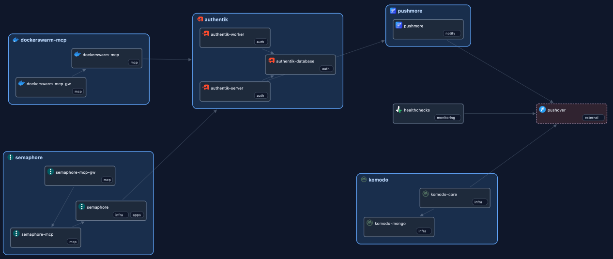

# Swarm dependency map

A containerized, read-only web application for exploring Docker Swarm service
dependencies and the impact of a service failure. Uses Python's standard library;
no Docker CLI, database, CDN, or third-party Python packages are needed.



## Labels

Add labels to your stack's services

```yaml
services:
  semaphore:
    image: your-semaphore-image
    deploy:
      labels:
        doc.category: "infra,apps"
        doc.icon: semaphore
        doc.depends_on: "stack:authentik"
  semaphore-mcp:
    image: your-semaphore-mcp-image
    deploy:
      labels:
        doc.category: mcp
        doc.icon: semaphore
        doc.depends_on: "semaphore_semaphore"
  semaphore-mcp-gw:
    image: your-mcp-gateway-image
    deploy:
      labels:
        doc.category: mcp
        doc.icon: semaphore
        doc.depends_on: "semaphore_semaphore-mcp"
```

## Examples

| Label | Example Value | Effect |
| -------------- |-------------|------|
| doc.depends_on | semaphore_semaphore | Dependency to the service Semaphore in the Semaphore-stack |
| doc.depends_on | stack:authentik | Dependency to the Authentik-stack |
| doc.depends_on | ext:pushover | Dependency to the external service Pushover |
| doc.used_by | ext:home-assistant | Dependency **from** the external service Home Assistant |
| doc.category | YourChoice | |
| doc.category | Multiple,Categories | |
| doc.icon | semaphore      | Will show icon from [homarr-labs/dashboard-icons](https://github.com/homarr-labs/dashboard-icons) |
| doc.icon | https://x.y/icon.png | Will show icon from https://x.y/icon.png (important to use https) |


## Run on a Swarm manager

```sh
docker build -t swarm-dependency-map:latest .
docker run -d --name swarm-dependency-map \
  --publish 127.0.0.1:8080:8080 \
  --group-add "$(stat -c '%g' /var/run/docker.sock)" \
  --volume /var/run/docker.sock:/var/run/docker.sock:ro \
  --read-only --cap-drop ALL --security-opt no-new-privileges \
  swarm-dependency-map:latest
```

For a stack deployment:

```sh
export DOCKER_GID="$(stat -c '%g' /var/run/docker.sock)"
docker stack deploy -c stack.yml dependency-map
```

Configuration via environment variables:

| Variable | Default | Purpose |
|---|---|---|
| `PORT` | `8080` | HTTP listening port (also update port mapping and image health check if changed) |
| `DOCKER_SOCKET` | `/var/run/docker.sock` | Unix socket path inside the container |


## Local development and tests

```sh
python3 app.py
python3 -m unittest discover -s tests -v
```

Tests use only the standard library, including a mock Docker Unix socket and a
local HTTP server; they do not require a running Docker daemon.
